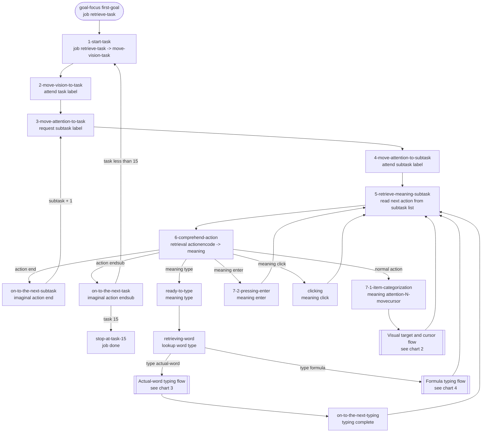
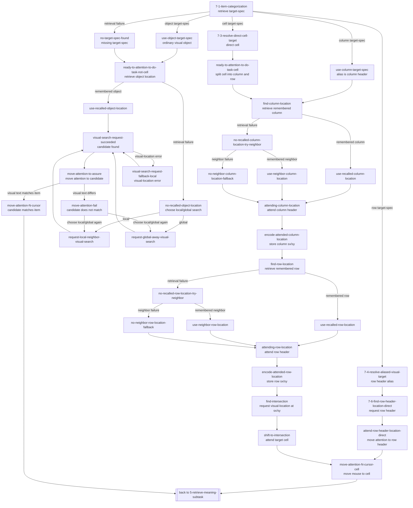
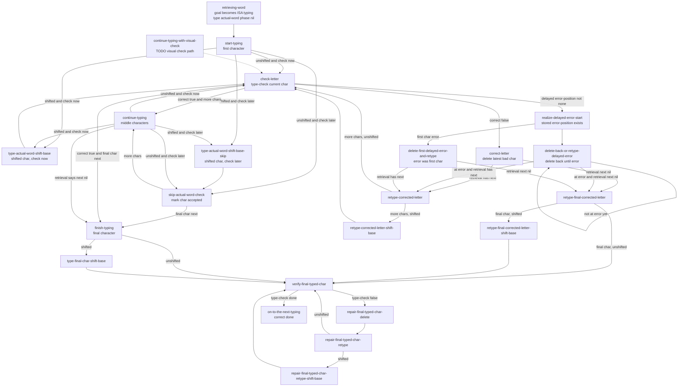
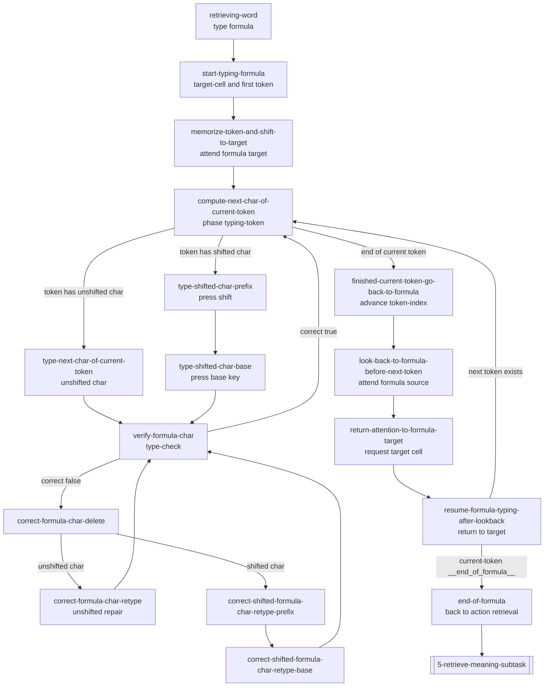

# ACT-R Model Production Flowchart

Source model: `New_Error (3-5-2-TCP).lisp`

This chart was built from the ACT-R production rules in the model. In ACT-R, the left side of a production tests buffer contents, and the right side after `==>` changes buffers or sends requests. Most movement between productions in this model is controlled by the `goal` buffer, especially `goal.job` for high-level control and `goal.phase` for typing.

## How To Read This

- Each box is a production rule from the Lisp file.
- Arrows show the next production family that becomes eligible after the current production changes `goal.job`, `goal.phase`, `goal.type`, or requests a visual/retrieval/manual buffer action.
- Branch labels describe the buffer result or condition that selects the path.
- The main action loop is `5-retrieve-meaning-subtask -> 6-comprehend-action -> action-specific productions -> 5-retrieve-meaning-subtask`.
- `end` moves to the next subtask. `endsub` moves to the next task. Task 15 stops the model.

## 1. Main Controller And Action Dispatch

## 2. Visual Target Search And Cursor Movement

This is the largest controller branch. It handles `Goto`, `Move`, and `Select` style actions whose meaning is `attention-N-movecursor`.

## 3. Actual-Word Typing And Repair

This branch is used when `retrieving-word` finds `type "actual-word"`. The model types character by character, optionally checks immediately, sometimes delays error realization, and repairs errors by deleting and retyping.

## 4. Formula Typing And Repair

This branch is used when `retrieving-word` finds `type formula`. Unlike actual-word typing, formula typing tokenizes the formula, looks back to the instruction/source between tokens, and then returns attention to the target cell.

## Production Coverage

The charts above include the following production groups:

- Controller: `1-start-task`, `2-move-vision-to-task`, `3-move-attention-to-task`, `4-move-attention-to-subtask`, `5-retrieve-meaning-subtask`, `6-comprehend-action`, `on-to-the-next-subtask`, `on-to-the-next-task`, `stop-at-task-15`.
- Action dispatch: `7-1-item-categorization`, `7-2-pressing-enter`, `clicking`, `ready-to-type`, `retrieving-word`, `on-to-the-next-typing`.
- Visual target/cursor movement: `7-3-resolve-direct-cell-target`, `7-4-resolve-aliased-visual-target`, `7-6-find-row-header-location-direct`, `attend-row-header-location-direct`, `use-column-target-spec`, `use-object-target-spec`, `no-target-spec-found`, `ready-to-attention-to-do-task-not-cell`, `use-recalled-object-location`, `no-recalled-object-location`, `request-local-neighbor-visual-search`, `request-global-away-visual-search`, `visual-search-request-succeeded`, `visual-search-request-fallback-local`, `ready-to-attention-to-do-task-cell`, `find-column-location`, `use-recalled-column-location`, `no-recalled-column-location-try-neighbor`, `use-neighbor-column-location`, `no-neighbor-column-location-fallback`, `attending-column-location`, `encode-attended-column-location`, `find-row-location`, `use-recalled-row-location`, `no-recalled-row-location-try-neighbor`, `use-neighbor-row-location`, `no-neighbor-row-location-fallback`, `attending-row-location`, `encode-attended-row-location`, `find-intersection`, `shift-to-intersection`, `move-attention-N-cursor-cell`, `move-attention-to-assure`, `move-attention-N-cursor`, `move-attention-fail`.
- Actual-word typing: `start-typing`, `type-actual-word-shift-base`, `type-actual-word-shift-base-skip`, `continue-typing`, `continue-typing-with-visual-check`, `skip-actual-word-check`, `realize-delayed-error-start`, `delete-back-or-retype-delayed-error`, `delete-first-delayed-error-and-retype`, `check-letter`, `correct-letter`, `retype-corrected-letter`, `retype-final-corrected-letter`, `retype-corrected-letter-shift-base`, `retype-final-corrected-letter-shift-base`, `finish-typing`, `type-final-char-shift-base`, `verify-final-typed-char`, `repair-final-typed-char-delete`, `repair-final-typed-char-retype`, `repair-final-typed-char-retype-shift-base`.
- Formula typing: `start-typing-formula`, `memorize-token-and-shift-to-target`, `compute-next-char-of-current-token`, `type-next-char-of-current-token`, `type-shifted-char-prefix`, `type-shifted-char-base`, `verify-formula-char`, `correct-formula-char-delete`, `correct-formula-char-retype`, `correct-shifted-formula-char-retype-prefix`, `correct-shifted-formula-char-retype-base`, `finished-current-token-go-back-to-formula`, `look-back-to-formula-before-next-token`, `return-attention-to-formula-target`, `resume-formula-typing-after-lookback`, `end-of-formula`.
